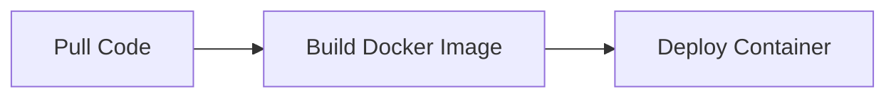

# CI/CD with Jenkins, Docker & Kubernetes (ITI)

    

> Jenkins pipeline that builds a Dockerised static site and deploys it to Kubernetes.

## Overview

A static demo sign-in page served by **Apache httpd**. A **Jenkins** pipeline clones the repo, builds the Docker image and runs it, and the `myapp/` folder holds the Kubernetes Deployment, NodePort Service and Secret used to deploy it on a cluster.

## Tech Stack

- **Jenkins**
- **Docker**
- **Kubernetes**
- **Apache httpd**
- **HTML/CSS**

## Repository Structure

```text
Dockerfile
index.html
Jenkinsfile
myapp/example.yml
myapp/iti-secret.yml
myapp/iti-service.yml
myapp/myapp-deployment.yml
README.md
```

## Getting Started

### Run with Docker

```bash
git clone https://github.com/Gamal-Mohammad/cicd_iti.git
cd cicd_iti
docker build -t cicd-iti .
docker run -d --name cicd-iti -p 8080:80 cicd-iti
```

Then open http://localhost:8080.

### Deploy to Kubernetes

| File | Kind | Name |
|---|---|---|
| `myapp/example.yml` | Deployment | `example-deployment` |
| `myapp/iti-secret.yml` | Secret | `iti` |
| `myapp/iti-service.yml` | Service | `nginx-deployment` |
| `myapp/myapp-deployment.yml` | Deployment | `nginx-deployment` |

```bash
kubectl apply -f myapp/example.yml
kubectl apply -f myapp/iti-secret.yml
kubectl apply -f myapp/iti-service.yml
kubectl apply -f myapp/myapp-deployment.yml
kubectl get pods,svc
```

## CI/CD Pipeline

The `Jenkinsfile` defines the following stages:



## Author

**Gamal Mohammad**

[](https://github.com/Gamal-Mohammad)
